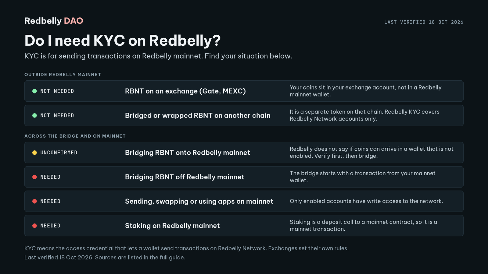

# Short version for pinning

Post the text below with the image `assets/decision-guide.png` (1600 x 900).
For a link preview use `assets/og-image.png` (1200 x 630).

```
KYC on Redbelly in one rule: you need it to send transactions on Redbelly mainnet.

Not needed: RBNT on an exchange, bridged or wrapped RBNT on another chain.
Needed: using mainnet, staking, bridging out.
Unconfirmed: bridging in. Verify first, then bridge.

Get verified at access.redbelly.network. Averer checks your identity, then you enable your account.

DAO: open to every region. Redbelly Network: not offered in 18 jurisdictions (terms, clause 15.1). These are separate rules.

Wallets: about 10 per verified identity. Stuck? Open a ticket at averer-help.freshdesk.com.

Last verified 18 Oct 2026.
```


