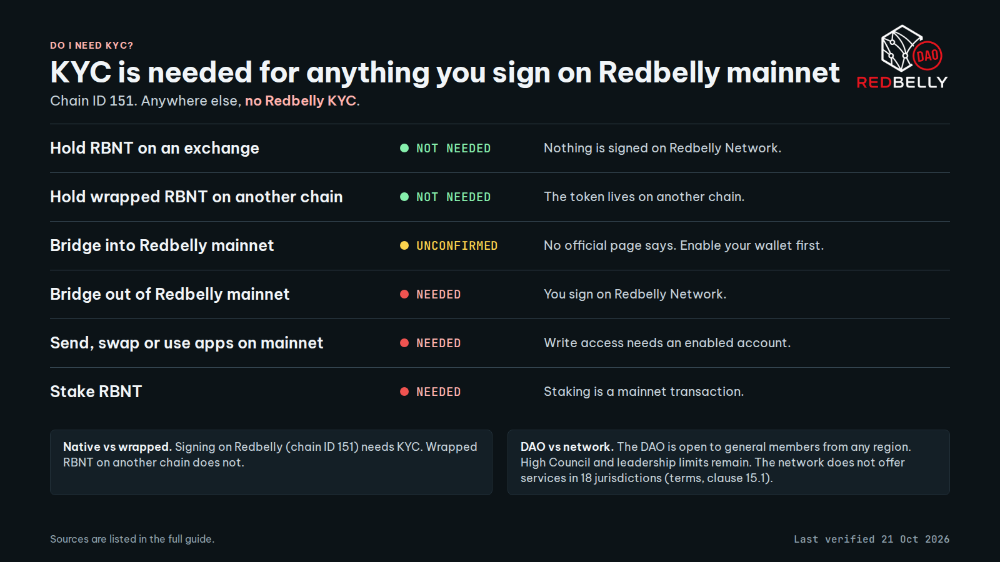

# Short version for pinning

Post the text below with `assets/decision-guide.png` (1600 x 900).
For a link preview use `assets/og-image.png` (1200 x 630).

```
KYC on Redbelly in 10 seconds

NEEDED: send, swap or use apps on mainnet. Bridge out of mainnet. Stake.
NOT NEEDED: RBNT on an exchange. Wrapped RBNT on another chain.
UNCONFIRMED: bridging into mainnet. No official page says. Enable your wallet first.

Wallets: 10 per verified identity. At 10 the portal shows "Account allocation exhausted."
Approval: usually a few minutes, rarely a few days (Redbelly Access says so).
DAO: open to general members from every region (vote passed 5 July 2026). Geographic limits remain for High Council members and DAO leadership. Network: not offered in the 18 jurisdictions in clause 15.1 of the terms. These are separate rules.
Get verified: access.redbelly.network
Stuck or rejected: https://averer-help.freshdesk.com/support/tickets/new
Never share a seed phrase.

Full guide and sources: https://wallet-activation.vercel.app/
Last verified 21 Oct 2026. Re-check the sources before relying on it.
```


